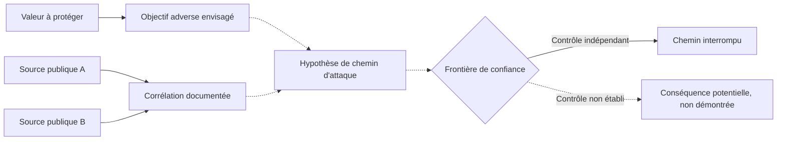
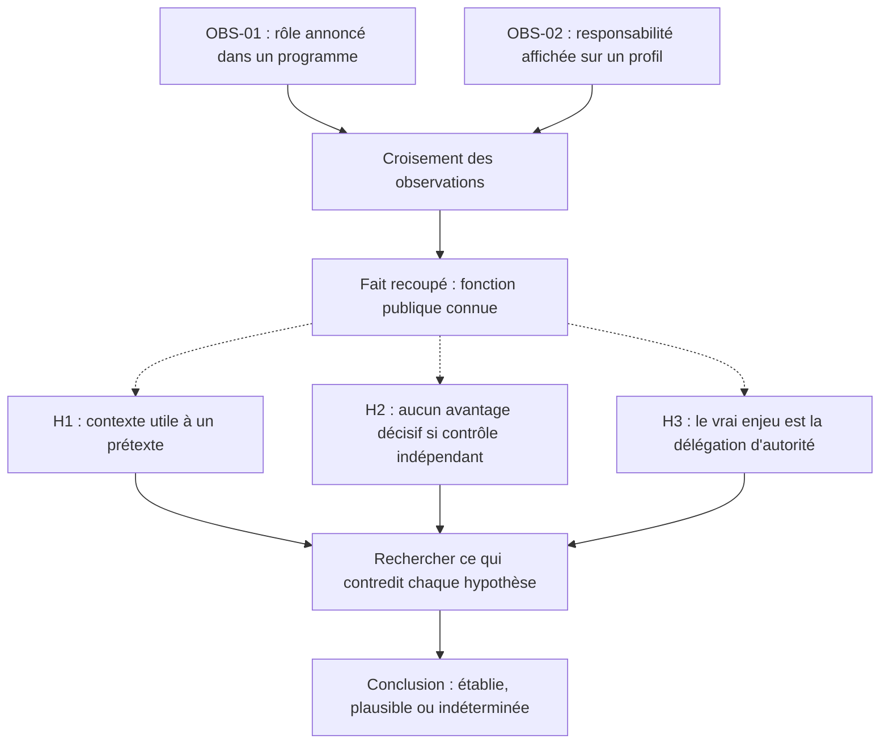

# PRE-ATT&CK Human Surface

**Laboratoire documentaire · Reconnaissance OSINT · Exposition humaine · Frontières de confiance**

[English version](README.en.md) · [Méthode](docs/demarche-osint-defensive.md) · [Exercice](examples/donnees-fictives-fr.md) · [Références](REFERENCES.md)

> **Question de recherche :** comment des informations publiques, individuellement anodines, peuvent-elles contribuer à un scénario de compromission — et à quelles conditions ce scénario pourrait-il réellement produire un effet ?

Une information publique n'est pas une vulnérabilité. Une corrélation n'est pas une compromission. Ce laboratoire sert à **documenter les liens possibles entre exposition, capacités adverses, décisions sensibles et contrôles**, sans confondre constat, inférence et preuve.

**État du projet :** laboratoire d'analyse documentaire, avec jeu de données **entièrement fictif** et exemple corrigé. Aucun collecteur OSINT, scan de tiers ou exercice d'ingénierie sociale n'est requis.

## Le problème, en un schéma

**Lecture :** les flèches pleines décrivent des relations documentées dans l'exercice ; les flèches pointillées représentent des **hypothèses** ou des conditions encore inconnues. Le schéma ne démontre pas qu'une attaque réussira.

## Réaliser le laboratoire

| Étape | Ce que vous produisez | Ressource |
| --- | --- | --- |
| **1. Cadrer** | Valeur, objectif adverse supposé et périmètre autorisé | [Démarche OSINT défensive](docs/demarche-osint-defensive.md) |
| **2. Modéliser** | Acteurs, relations d'autorité et frontière de confiance | [Modèle de menace](docs/modele-de-menace-fr.md) |
| **3. Observer** | Registre d'observations **synthétiques**, chacune avec ses limites | [Jeu de données fictives](examples/donnees-fictives-fr.md) |
| **4. Analyser** | Hypothèses concurrentes, éléments contradictoires, inconnues | [Fiche d'analyse vierge](examples/fiche-analyse-fr.md) |
| **5. Conclure** | Mesures, vérification envisagée, conclusion proportionnée | [Cas corrigé](examples/exemple-revue-fr.md) |
| **6. Situer** | Correspondances ATT&CK sans assimiler technique et preuve | [Correspondance MITRE ATT&CK](docs/correspondance-mitre-fr.md) |

Pour approfondir : [exposition des identités professionnelles](docs/identites-professionnelles-fr.md). Les documents originaux en anglais restent accessibles depuis la [version anglaise](README.en.md).

## Des observations aux hypothèses

La démarche est **contradictoire** : une hypothèse doit être exposée à des éléments susceptibles de l'infirmer, pas seulement alimentée en indices concordants.

## Discipline de preuve

| Étiquette | Ce qu'elle autorise à affirmer |
| --- | --- |
| **OBSERVÉ** | Le contenu exact apparaît dans une source examinée, à une date donnée. |
| **DOCUMENTÉ** | Une capacité, un processus ou un contrôle est décrit par une référence vérifiable. |
| **HYPOTHÈSE** | Une possibilité argumentée, accompagnée de conditions et de contradictions. |
| **INCONNU** | Une information non établie, qui interdit une conclusion trop forte. |

Ne pas confondre **identité**, **fonction affichée**, **permission technique** et **autorité effectivement reconnue**. Une fonction indiquée publiquement ne prouve pas l'existence d'un accès privilégié.

## Cadre, limites et attribution

Le dépôt est **défensif** et repose uniquement sur des sources publiques ou des informations examinées dans un cadre explicitement autorisé. Les exercices utilisent des données fabriquées. Pas de sollicitation de personnes, de surveillance physique, de collecte intrusive ni de tentative de contournement. Voir la [politique de sécurité](SECURITY.md).

Le nom **PRE-ATT&CK** est descriptif et historique : MITRE a retiré le domaine distinct en octobre 2020, dont le périmètre a été repris principalement par *Reconnaissance* et *Resource Development*. Il ne s'agit ni d'un référentiel officiel MITRE, ni d'une reproduction d'ATT&CK. [Source MITRE](https://attack.mitre.org/resources/updates/updates-october-2020/).

**Principe de sortie :** une décision justifiée, un contrôle à examiner et une limite explicite — pas une accumulation de données personnelles.

[Licence CC BY 4.0](LICENSE) · © 2026 lxrider · [Références et sources](REFERENCES.md)
