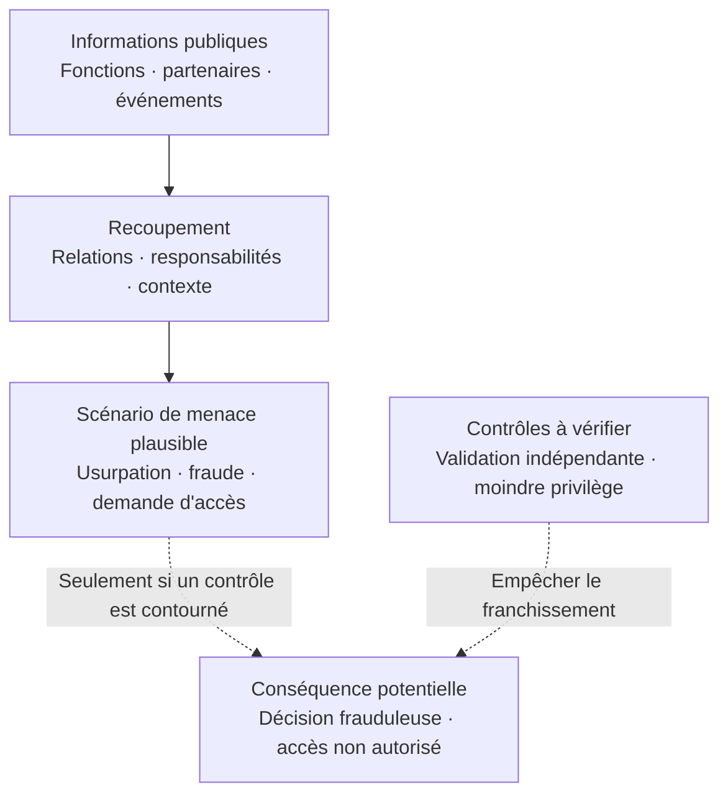

# Ce que votre organisation révèle sans le savoir

**PRE-ATT&CK Human Surface — Analyse des expositions humaines et organisationnelles**

[English](README.en.md) · [Sources et références](REFERENCES.md)

## Le risque ne se limite pas à vos systèmes exposés

Votre organisation publie chaque jour des informations utiles : noms et fonctions, recrutements, projets, partenaires, événements, technologies et responsabilités.

Prises isolément, ces informations sont souvent anodines. **Recoupées, elles peuvent aider un adversaire à comprendre qui décide, qui dispose d'un accès privilégié et quels contrôles il pourrait chercher à contourner.**

L'enjeu n'est pas de rendre l'organisation invisible. Il est de savoir si une information accessible à tous peut faciliter une action non autorisée sur ce qui compte pour l'entreprise.

## Du renseignement public à la conséquence possible

*Ce schéma illustre un raisonnement défensif, pas une attaque constatée. Une information publique ne prouve ni un privilège réel, ni une vulnérabilité, ni la possibilité de franchir un contrôle.*

## Exemple : une demande qui paraît légitime

**Situation fictive.** Une entreprise annonce publiquement la participation de sa responsable des identités à un salon. Son profil professionnel décrit son périmètre. Un communiqué présente un prestataire avec lequel elle collabore.

Ces éléments pourraient donner du crédit à une demande urgente se présentant comme venant d'un interlocuteur connu. **Cela ne démontre pas que la demande réussirait.** Le point décisif est ailleurs : une procédure interne permet-elle de valider une demande sensible sans se fier uniquement au nom, au contexte ou à l'urgence invoquée ?

## Trois décisions utiles

1. **Identifier les décisions et accès sensibles.** Qui peut autoriser un paiement, modifier des droits, réinitialiser un compte privilégié ou intervenir sur un système critique ?
2. **Vérifier les frontières de confiance.** Une information publique ou une relation supposée peut-elle suffire à déclencher l'une de ces actions ? Exiger une vérification indépendante.
3. **Réduire l'exposition inutile, puis contrôler l'effet.** Supprimer les détails non nécessaires et vérifier que les procédures restent robustes même si l'adversaire connaît l'organisation.

## Ce que cette recherche apporte

Cette étude indépendante examine **les liens entre exposition publique, autorité, chemins de compromission plausibles et conséquences métier**. Elle distingue les faits observables, les capacités documentées, les hypothèses et les inconnues.

**La question à poser n'est pas « combien d'informations sont visibles ? », mais « que pourrait-on en faire, et qu'est-ce qui l'empêche réellement ? »**

---

**Périmètre et éthique.** Analyse défensive de sources publiques ou explicitement autorisées. Aucun ciblage de personnes, collecte intrusive ou test d'ingénierie sociale. Les scénarios sont illustratifs ; ils ne constituent pas la preuve d'une compromission.

**Pour les équipes techniques :** [OSINT défensif](docs/defensive-osint.md) · [Modèle de menace](docs/threat-model.md) · [Correspondances MITRE ATT&CK](docs/mitre-mapping.md) · [Politique de sécurité](SECURITY.md).

*PRE-ATT&CK est ici un terme descriptif : MITRE a intégré cet ancien domaine aux tactiques Reconnaissance et Resource Development d'ATT&CK.*
