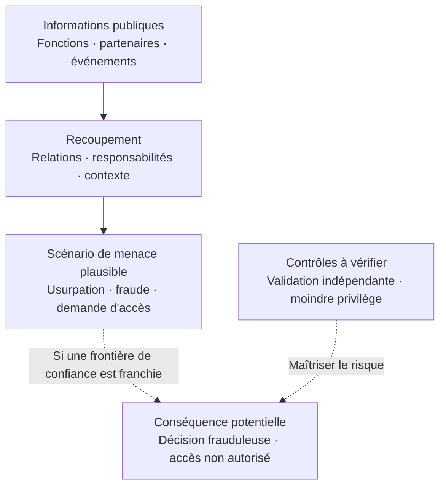

# Ce que votre organisation révèle sans le savoir

**PRE-ATT&CK Human Surface — Analyse des expositions humaines et organisationnelles**

[English](README.en.md) · [Sources et références](REFERENCES.md)

## Votre surface d'exposition humaine et organisationnelle

Votre organisation publie chaque jour des informations utiles : noms et fonctions, recrutements, projets, partenaires, événements, technologies et responsabilités.

Prises isolément, ces informations sont souvent anodines. **Recoupées, elles peuvent aider un adversaire à comprendre qui décide, qui dispose d'un accès privilégié et quels contrôles il pourrait chercher à contourner.**

L'enjeu consiste à comprendre comment les informations accessibles à tous peuvent faciliter une action sur les actifs et les décisions sensibles de l'entreprise, puis à renforcer les contrôles adaptés.

## Du renseignement public à la conséquence possible

*Ce schéma présente un scénario défensif hypothétique. L'analyse vérifie séparément les privilèges réels, les contrôles existants et les conditions de franchissement d'une frontière de confiance.*

## Exemple : une demande qui paraît légitime

**Situation fictive.** Une entreprise annonce publiquement la participation de sa responsable des identités à un salon. Son profil professionnel décrit son périmètre. Un communiqué présente un prestataire avec lequel elle collabore.

Ces éléments pourraient donner du crédit à une demande urgente se présentant comme venant d'un interlocuteur connu. **La réussite de cette tentative dépendrait des contrôles en place.** La question décisive : comment les procédures internes valident-elles une demande sensible, indépendamment du nom, du contexte ou de l'urgence invoquée ?

## Trois décisions utiles

1. **Identifier les décisions et accès sensibles.** Qui peut autoriser un paiement, modifier des droits, réinitialiser un compte privilégié ou intervenir sur un système critique ?
2. **Vérifier les frontières de confiance.** Une information publique ou une relation supposée peut-elle suffire à déclencher l'une de ces actions ? Exiger une vérification indépendante.
3. **Réduire l'exposition inutile, puis contrôler l'effet.** Limiter les détails superflus et vérifier la robustesse des procédures face à un interlocuteur qui connaît déjà l'organisation.

## Ce que cette recherche apporte

Cette étude indépendante examine **les liens entre exposition publique, autorité, chemins de compromission plausibles et conséquences métier**. Elle distingue les faits observables, les capacités documentées, les hypothèses et les inconnues.

**La question décisive : « Quelles actions ces informations pourraient-elles faciliter, et quels contrôles permettent de les maîtriser ? »**

---

**Périmètre et éthique.** Analyse défensive de sources publiques ou explicitement autorisées. Les scénarios fictifs servent à examiner les risques et les contrôles, dans le respect des personnes et des systèmes. Les conclusions distinguent les faits établis des hypothèses.

**Pour les équipes techniques :** [OSINT défensif](docs/defensive-osint.md) · [Modèle de menace](docs/threat-model.md) · [Correspondances MITRE ATT&CK](docs/mitre-mapping.md) · [Politique de sécurité](SECURITY.md).

*PRE-ATT&CK est ici un terme descriptif : MITRE a intégré cet ancien domaine aux tactiques Reconnaissance et Resource Development d'ATT&CK.*
