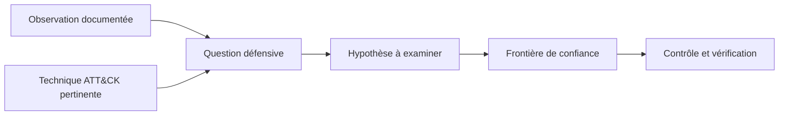

# Correspondance MITRE ATT&CK — Lecture défensive

[← Accueil](../README.md) · [Méthode](demarche-osint-defensive.md) · [Références](../REFERENCES.md)

**Objectif :** utiliser certaines techniques ATT&CK pour formuler des questions défensives. Cette correspondance **n'attribue aucune technique à un acteur observé** et ne prétend pas démontrer une compromission.

MITRE a retiré le domaine distinct PRE-ATT&CK en octobre 2020. Les comportements préparatoires sont notamment organisés dans les tactiques [TA0043 — Reconnaissance](https://attack.mitre.org/tactics/TA0043/) et [TA0042 — Resource Development](https://attack.mitre.org/tactics/TA0042/).

| Type d'information ou de comportement | Référence | Question pour la défense |
| --- | --- | --- |
| Identités, contacts, fonctions | [T1589 — Gather Victim Identity Information](https://attack.mitre.org/techniques/T1589/) | Quelles identités publiques peuvent être reliées à des responsabilités sensibles ? |
| Organisation, rôles, relations professionnelles | [T1591 — Gather Victim Org Information](https://attack.mitre.org/techniques/T1591/) | Que rend-on public sur les circuits de décision et la chaîne de confiance ? |
| Réseaux sociaux, sites publics, dépôts publics | [T1593 — Search Open Websites/Domains](https://attack.mitre.org/techniques/T1593/) | Quels recoupements sont réalisables sans interaction avec une cible ? |
| Site et publications de l'organisation | [T1594 — Search Victim-Owned Websites](https://attack.mitre.org/techniques/T1594/) | Nos propres contenus diffusent-ils des informations superflues ? |
| Bases DNS, certificats, données techniques ouvertes | [T1596 — Search Open Technical Databases](https://attack.mitre.org/techniques/T1596/) | Quels liens techniques sont visibles dans les sources ouvertes ? |
| Services d'IA accessibles au public | [T1682 — Query Public AI Services](https://attack.mitre.org/techniques/T1682/) | Les réponses sont-elles corroborées par une source primaire ? |
| Contenu produit pour faciliter une opération adverse | [T1683 — Generate Content](https://attack.mitre.org/techniques/T1683/) | La procédure interne résiste-t-elle à une demande convaincante mais non vérifiée ? |
| Sources à accès fermé | [T1597 — Search Closed Sources](https://attack.mitre.org/techniques/T1597/) | Existe-t-il un droit explicite de consulter cette source ? |
| Sondage actif d'une infrastructure | [T1595 — Active Scanning](https://attack.mitre.org/techniques/T1595/) | Un test actif est-il nécessaire et formellement autorisé ? **Hors du présent lab**. |

**Distinctions importantes :** T1682 couvre la consultation de services d'IA pour la reconnaissance ; T1683 relève de la préparation de ressources ou contenus. Ni l'utilisation d'une IA ni l'existence d'un contenu synthétique ne prouvent qu'une attaque est en cours. Les libellés de techniques sont conservés en anglais afin d'éviter une traduction ambiguë des identifiants officiels.

## ATT&CK ne remplace pas l'analyse

Une étiquette ATT&CK est une **aide à la qualification**, pas une preuve de causalité ni une mesure du risque. Les impacts, les permissions réelles, les contrôles effectivement appliqués et la vraisemblance doivent être examinés séparément.

**Sources :** pages officielles MITRE liées dans le tableau ; [annonce du retrait de PRE-ATT&CK (octobre 2020)](https://attack.mitre.org/resources/updates/updates-october-2020/). Correspondance revue le **10 novembre 2026**, non exhaustive ; les versions d'ATT&CK sont susceptibles d'évoluer.

[Version originale en anglais](mitre-mapping.md)
