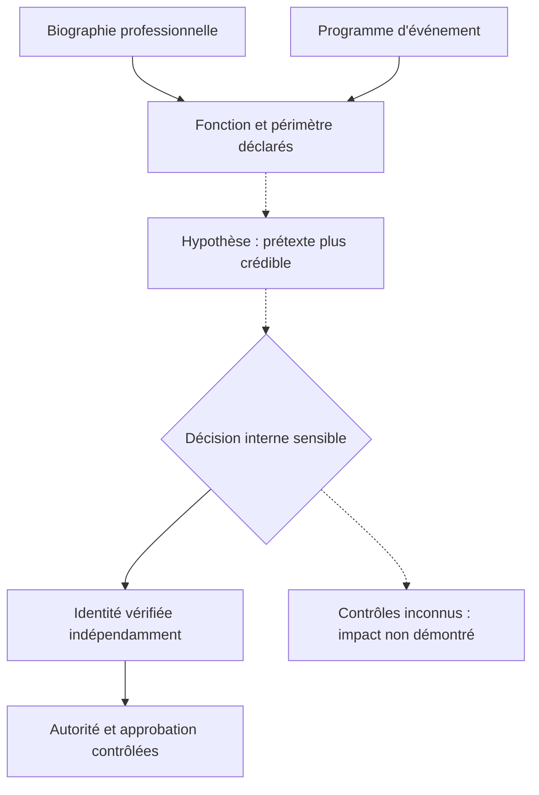

# Exposition des identités professionnelles

[← Accueil](../README.md) · [Modèle de menace](modele-de-menace-fr.md) · [Méthode](demarche-osint-defensive.md)

## Problème étudié

Les publications professionnelles sont légitimes et souvent utiles. Leur corrélation peut toutefois faire apparaître des **fonctions**, des **relations** ou des **contextes** susceptibles d'améliorer la crédibilité d'une demande hostile.

Il ne s'agit ni de rendre les personnes invisibles ni de rechercher des informations privées. L'objectif est d'évaluer **quelles informations contribuent réellement à une capacité adverse plausible** et quelles mesures protègent les décisions importantes.

## Distinguer les niveaux

| Niveau | Ce que l'on peut décrire | Ce que cela ne démontre pas |
| --- | --- | --- |
| Publication | Un nom et une fonction affichés dans un programme public | Une identité vérifiée en contexte opérationnel |
| Corrélation | La même fonction apparaît sur deux supports publics | Une session active ou un compte interne |
| Contexte | Un événement est annoncé à une date donnée | La présence effective ou l'absence d'une personne |
| Responsabilité | Une personne présente une spécialité IAM | Des permissions administratives réelles |
| Autorité | Un rôle est indiqué dans un organigramme | Une délégation opposable ou un droit d'approbation |

## Sources ouvertes et limites

Les familles de sources envisageables dans un exercice autorisé sont : pages institutionnelles, biographies professionnelles diffusées volontairement, programmes publics, annonces de projets, dépôts publics dont l'accès est légitime, et métadonnées de documents publics nécessaires à l'analyse.

Chaque source doit avoir un **lien vérifiable**, une **date de consultation** et un **périmètre documenté**. Une information recopiée sur plusieurs sites n'est pas forcément corroborée : elle peut provenir d'une unique origine.

Les moteurs de recherche et services d'IA peuvent fournir des **pistes**, pas automatiquement des preuves. Il faut contrôler les résultats sur les documents d'origine et éviter les copies nominatives inutiles.

## Du contexte public à une décision interne

**Point décisif :** un processus sûr ne transforme pas la connaissance d'un nom, d'un projet ou d'un calendrier public en preuve suffisante d'identité ou d'autorité.

## Mesures proportionnées

- Supprimer les détails **non nécessaires** sur les accès, contacts et mécanismes internes lorsque leur publication ne sert aucun besoin identifié.
- Réfléchir à la précision temporelle des communications, sans imposer de discrétion injustifiée à toutes les activités professionnelles.
- Séparer les informations de communication publique des procédures internes d'authentification et d'approbation.
- Contrôler les délégations, les escalades et les procédures de récupération de comptes privilégiés dans le cadre d'une revue **explicitement autorisée**.
- Vérifier l'effet réel des changements : une page modifiée n'efface pas automatiquement les copies, archives ou publications tierces.

## Ce que le laboratoire ne fait pas

Pas de profilage de personnes réelles, d'achat de données personnelles, de corrélation intrusive, d'interactions sous fausse identité, de tests sur des employés ou d'inférence d'itinéraires individuels. Les exemples du dépôt sont fictifs.

Ce document est une **synthèse française pour le parcours du lab**, et non une traduction exhaustive de la [note approfondie en anglais](professional-identity-exposure.md).
