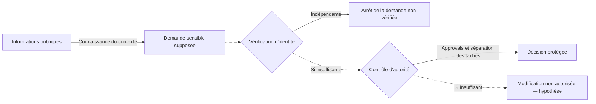

# Modèle de menace — Exposition humaine et autorité

[← Accueil](../README.md) · [Méthode](demarche-osint-defensive.md) · [Exercice](../examples/donnees-fictives-fr.md)

## Question directrice

> Quelle **décision sensible** un adversaire chercherait-il à influencer, au moyen de quelles informations publiques et en franchissant quelle **frontière de confiance** ?

Le modèle vise un processus ou une capacité à protéger, **pas un profil psychologique** d'une personne.

## Cinq familles d'information

| Famille | Exposition possible | Limite de l'inférence |
| --- | --- | --- |
| **Identité** | Noms, pseudonymes professionnels, comptes publics | Ne prouve ni la maîtrise d'un compte ni son authentification |
| **Fonction** | Intitulé de poste, intervention, spécialité | Ne prouve pas les privilèges réels |
| **Relations** | Partenaires, fournisseurs, organigramme public | Ne prouve pas une délégation d'autorité |
| **Contexte** | Projet, technologie citée, événement | Ne prouve pas l'accès au système évoqué |
| **Temporalité** | Date publique d'un événement, publication différée | Ne confirme pas une présence ni une absence |

## Identifier les frontières

Les deux contrôles répondent à des questions différentes : **qui formule la demande ?** et **cette personne est-elle autorisée à la faire exécuter ?** Le fait qu'une information soit publique ne dit rien de leur efficacité réelle.

## Hypothèses minimales

- **H1 — Exposition facilitatrice :** les informations corrélées rendent une demande frauduleuse plus crédible.
- **H2 — Contrôle indépendant :** la connaissance du contexte ne change pas la décision du support, qui s'appuie sur une vérification indépendante.
- **H3 — Autorité mal attribuée :** le facteur déterminant serait une procédure de délégation ou d'escalade, et non l'exposition en elle-même.

Pour chacune : chercher ce qui la **soutient**, ce qui la **contredit**, et ce qui **reste inconnu**. Un même fait public peut être compatible avec plusieurs hypothèses.

## Règles de périmètre

Aucune prise de contact, interaction avec un individu, recherche de coordonnées privées, collecte de données volées ou vérification intrusive n'est nécessaire. Les permissions et procédures internes sont **INCONNUES** si elles ne sont pas fournies dans le cadre autorisé.

**Sortie attendue :** une cartographie courte des faits, des frontières et des contrôles à vérifier, sans conclusion non étayée sur les personnes.

[Version originale en anglais](threat-model.md)
