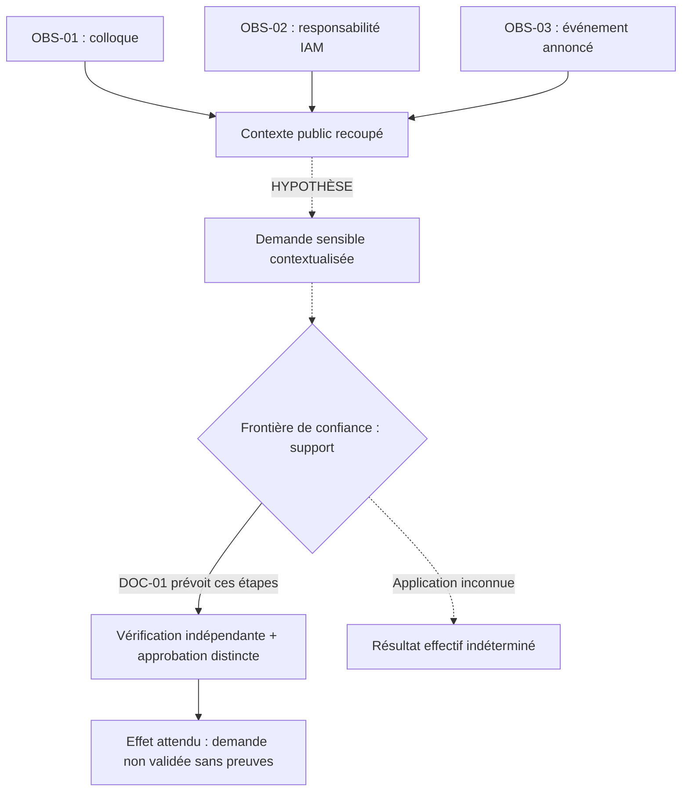

# Exercice 01 — Correction commentée

[← Accueil](../README.md) · [Données synthétiques](donnees-fictives-fr.md) · [Fiche vierge](fiche-analyse-fr.md)

> **Cas entièrement fictif.** La correction est une illustration d'analyse, non une observation de sécurité réelle et non une preuve de compromission.

## 1. Cadrage

**Valeur :** intégrité des comptes privilégiés et du processus de récupération d'accès.  
**Effet redouté :** modification non autorisée d'un accès sensible.  
**Objectif adverse hypothétique :** faire accepter une demande sensible en utilisant une connaissance du contexte professionnel.

Aucune tentative de fraude n'est observée. L'exercice ne démontre pas que la personne mentionnée dispose d'un compte privilégié.

## 2. Observations et corrélations

| Élément | Ce que la pièce permet de dire | Ce qu'elle ne permet pas de dire |
| --- | --- | --- |
| **OBS-01 + OBS-02** | Une même identité est associée publiquement à une activité IAM et à l'organisation | La personne détient des permissions IAM |
| **OBS-03** | Une publication annonce une participation envisagée | Un déplacement effectif est confirmé |
| **OBS-04** | Un service d'assistance aux comptes est mentionné | Sa procédure serait faible ou contournable |
| **DOC-01** | Une procédure fictive prévoit deux contrôles distincts | Les contrôles seraient effectivement suivis dans chaque situation |

La convergence des identités OBS-01 et OBS-02 est une **corrélation documentaire**. Si les deux sources reprenaient la même biographie initiale, il ne faudrait pas compter cette répétition comme deux confirmations indépendantes.

## 3. Chemin hypothétique et frontière

La **frontière** n'est pas l'accès à la biographie : c'est la transition vers une **décision d'accès interne**. Il faut distinguer la preuve d'identité de la preuve d'autorité.

## 4. Hypothèses contradictoires

| Hypothèse | Éléments favorables | Éléments contraires / limites | Conclusion |
| --- | --- | --- | --- |
| **H1 — L'exposition facilite un prétexte** | OBS-01, OBS-02 et OBS-03 fournissent un contexte cohérent | Aucune réponse d'un service interne n'est documentée | **Plausible, non démontrée** |
| **H2 — Les contrôles neutralisent l'avantage informationnel** | DOC-01 impose vérification indépendante et approbation | L'application réelle du contrôle est inconnue | **Documentée sur le principe, efficacité non vérifiée** |
| **H3 — Le risque se situe dans la délégation d'autorité** | Une modification d'accès suppose une validation | Aucune donnée sur les rôles, dérogations ou escalades | **Indéterminée** |

Une accumulation d'observations publiques **ne tranche pas** ces trois hypothèses. La procédure documentaire n'est pas la preuve de son application.

## 5. Traitements proposés et preuves attendues

| Action | Vérification pertinente | Limite à déclarer |
| --- | --- | --- |
| Éviter des détails temporels inutiles dans les annonces publiques | Comparer, dans un périmètre défini, les informations publiées avant/après | Copies historiques et sources tierces possibles |
| Revoir une procédure de récupération d'accès dans un cadre interne autorisé | Vérifier séparément identité, autorité, validation et gestion des dérogations | Sans revue effective, **efficacité inconnue** |

Ne pas annoncer « risque réduit » sur la seule base d'une suppression de contenu. Il faut distinguer la **baisse d'exposition**, la **rupture d'un chemin hypothétique** et la **preuve de fonctionnement d'un contrôle**.

## 6. Conclusion défendable

Les pièces fictives permettent de décrire une **corrélation de contexte** autour d'une fonction IAM. Elles ne permettent pas de démontrer un accès privilégié, une vulnérabilité de procédure ou un succès adverse. Le contrôle indépendant décrit dans DOC-01 est pertinent en conception ; son application reste inconnue.

**Décision conseillée :** examiner l'utilité de l'exposition et, surtout, vérifier par les responsables autorisés l'effectivité des procédures de validation. **Niveau d'assurance :** élevé sur le contenu du jeu synthétique ; indéterminé sur une efficacité opérationnelle, non testée.

[Reprendre le dossier](donnees-fictives-fr.md) · [Comparer avec la fiche vierge](fiche-analyse-fr.md)
